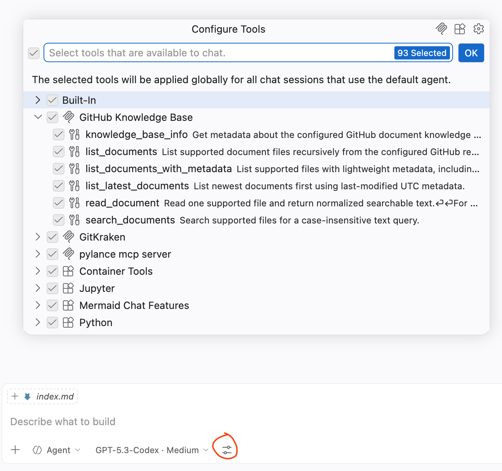
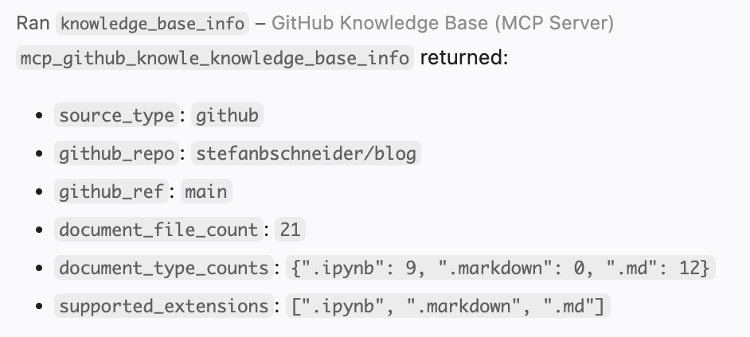
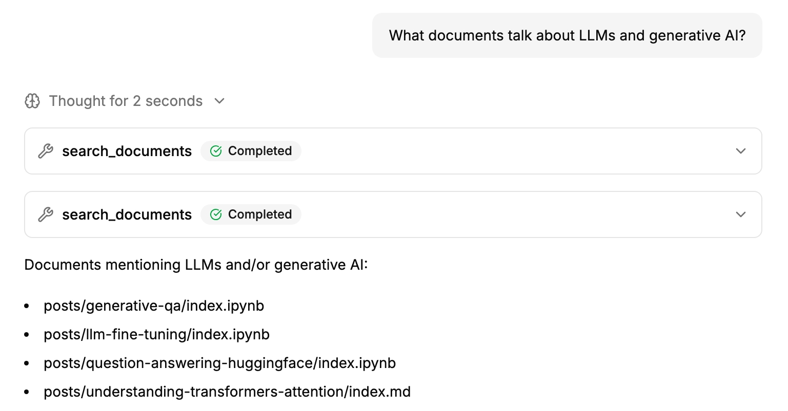

---
aliases:
- /fastmcp
date: '2026-04-12'
# date-modified: '2023-12-10'
title: Building and Using Your Own MCP with FastMCP
description: Quickly building a custom MCP server (remote knowledge base) with FastMCP and using it within VSCode and Copilot.
image: images/fastmcp-logo.png
categories: [fastmcp, python, mcp, github, vscode, copilot, machine learning, ai agents]
published: false
---

The [Model Context Protocol (MCP)](https://modelcontextprotocol.io/) provides a clean way to expose tools and data sources to AI assistants such as Claude and Copilot. 
Instead of hardcoding one-off integrations, an MCP server publishes capabilities such as search, read, and metadata retrieval.

This post walks through building a lightweight MCP server with [FastMCP](https://gofastmcp.com/) and connecting it to Copilot in VSCode. The concrete example is a **GitHub Knowledge Base MCP**, which turns a public GitHub repository containing markdown and notebook documents into a searchable knowledge base - the [repo behind this blog](https://github.com/stefanbschneider/blog) is a perfect example for such a knowledge base.

# Why using MCP?

MCP is useful when assistants need reliable access to external tools and data. Key reasons:

- standard integration across MCP-compatible clients
- structured, discoverable tool interfaces (instead of brittle text parsing)
- safer, more maintainable integrations that are easy to reuse

MCP vs. CLI: CLIs remain excellent for direct human workflows and quick one-off commands. MCP becomes the better fit once an assistant needs repeatable, machine-friendly access to tools. A CLI is optimized for terminal interaction, while MCP is optimized for programmatic tool calls with schema-driven inputs and outputs. In practice, this leads to fewer parsing errors, clearer integration boundaries, and easier reuse across different assistants and editor environments.


# Building an MCP server with FastMCP

FastMCP is a Python framework for building MCP servers with minimal boilerplate. It is a good fit when custom tools or data sources should be exposed to assistants quickly, without implementing the full protocol plumbing from scratch.

FastMCP makes server creation straightforward: define a server, annotate Python functions as tools, and run it over stdio. After that, an MCP client like an AI assistant can call those tools directly.

## FastMCP Installation and Quickstart

Creating a FastMCP server is simple. All it nees is a `FastMCP(...)` instance, some tool functions decorated with `@mcp.tool`, and a run entrypoint (`mcp.run()`).

Here is a minimal but complete working example (`server.py`) similar to the [official FastMCP quickstart](https://gofastmcp.com/getting-started/quickstart):

```python
from fastmcp import FastMCP

mcp = FastMCP("Hello MCP")


@mcp.tool
def ping(name: str = "world") -> dict:
	"""Simple tool to verify the server is reachable."""
	return {"message": f"Hello, {name}!"}


@mcp.tool
def add(a: float, b: float) -> float:
	"""Return the sum of two numbers."""
	return a + b


if __name__ == "__main__":
	mcp.run()
```

After installing FastMCP (`uv add fastmcp` or `pip install fastmcp`), the FastMCP CLI can run the server directly:

```bash
fastmcp run server.py
```

That is enough to get a fully working MCP server with two callable tools.


## Building a Remote GitHub Knowledge Base MCP

As an example for a more useful, yet still quite simple MCP server, I built a GitHub Knowledge Base MCP.
The idea behind it is to turn any public GitHub repository into a remote knowledge base by providing tools that can search and read the repo's markdown and notebook documents.
My goal is to demnostrate the MCP based on my blog repo, which contains all blog posts as documents. 
With the MCP, an AI assistant can then quickly search available posts or retrieve the latest post.

To do so, I created a minimal FastMCP server with the following tool functions:

- `knowledge_base_info`: inspect source and supported file types
- `list_documents`: list supported documents (`.md`, `.markdown`, `.ipynb`) recursively in all folders of the repo
- `read_document`: read normalized text from `.md`, `.markdown`, and `.ipynb`
- `list_documents_with_metadata`: include size and last-modified timestamps
- `list_latest_documents`: quickly fetch newest files based on the metadata
- `search_documents`: case-insensitive search with snippets

Under the hood, this server relies on the [GitHub REST API](https://docs.github.com/en/rest) plus raw file fetches from `raw.githubusercontent.com`, with lightweight in-memory caching to avoid repeating identical API calls.

Notebook handling is intentionally simple: only markdown cells are extracted from `.ipynb`, so results stay focused on human-written documentation.

The GitHub Knowledge Base MCP is configured with:

- `KB_GITHUB_REPO`: repository in `owner/repo` or GitHub URL format
- optional `KB_GITHUB_BRANCH`: branch/tag/SHA; defaults to the repo default branch

My final GitHub Knowledge Base MCP is available on GitHub: [**stefanbschneider/github-knowledge-base-mcp**](https://github.com/stefanbschneider/github-knowledge-base-mcp)


# Using a custom MCP with Copilot in VSCode

## Configuration in mcp.json

In VSCode, add the MCP server via **MCP: Add server...** or `mcp.json` (see the [VSCode MCP server docs](https://code.visualstudio.com/docs/copilot/chat/mcp-servers)). Point it to `fastmcp run server.py` and provide environment variables:

```json
"GitHub Knowledge Base": {
	"type": "stdio",
	"command": "${workspaceFolder}/.venv/bin/fastmcp",
	"args": ["run", "server.py"],
	"env": {
		"KB_GITHUB_REPO": "stefanbschneider/blog"
	}
}
```

To verify that the MCP server was configured correctly and is picked up by Copilot, click the "Configure Tools..." button in the Copilot chat.
It should show a list of available MCP servers, hopefully including the newly added "GitHub Knowledge Base" with its tools:




## Usage in Copilot

Once connected, you can call the MCP or specific tools explicitly from the Copilot chat via the hashtag command, e.g., `#knowledge_base_info` will call the corresponding tool and provide an overview of the connected knowledge base:



In addition to explicitly calling the tools, Copilot can also call them dynamically based on the provided prompt. Eg, when asking for the latest document in the connected knowledge base or when searching for documents for a certain topic.




# Helpful Pointers

- [The GitHub Knowledge Base MCP Repository](https://github.com/stefanbschneider/github-knowledge-base-mcp)
- [MCP Docs](https://modelcontextprotocol.io/docs/getting-started/intro)
- [FastMCP Docs](https://gofastmcp.com/getting-started/welcome)
- [Collection of useful MCP servers](https://mcpservers.org/)
- [VSCode MCP Configuration](https://code.visualstudio.com/docs/copilot/customization/mcp-servers)
